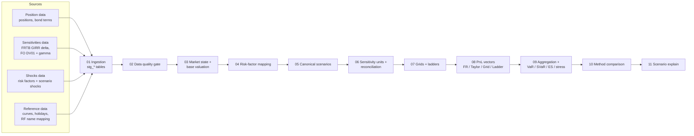

# Market Risk Projection Engine (PySpark)

An end-to-end, bank-style **PnL projection engine**: it ingests positions, sensitivities, scenario
shocks and market data from four upstream sources, maps everything onto a common set of risk
factors, and produces **PnL vectors** (one PnL per position per scenario) with four methods:

1. **Full revaluation**: reprice every cash flow on every shocked curve (the benchmark)
2. **Sensitivity-based (Taylor)**: delta + gamma, using FRTB SA deltas and front-office gammas
3. **Grid-based**: pre-computed revaluation grid + interpolation
4. **Ladder-based**: one revaluation ladder per risk factor, contributions added up

The vectors are aggregated position → book → desk → portfolio and turned into **1-day 99% VaR,
SVaR, 97.5% ES and stress results**. Each approximation is then measured against full
revaluation with PLA-test style statistics.

Release 0.2 prices **fixed-rate bonds**. The framework (product registry, risk-factor model,
methods) is built for the planned products: floating-rate bonds, IRS, FX forwards, equities and
equity options.

> **Data disclaimer:** All data in `data/source/` is synthetic and generated by
> `scripts/generate_sample_data.py`. It is not data from any financial institution, and it does
> not represent any institution's systems, schemas, models or methodologies. The source names
> (position, sensitivity, shock and reference data) are generic labels.

A full sample run, with the output of every step, is in
**[docs/sample_run_report.md](docs/sample_run_report.md)**. The formulas and the approximation
errors are explained in **[docs/METHODOLOGY.md](docs/METHODOLOGY.md)**.

---

## Pipeline



| Step | What happens | Engine tables (Parquet, `data/warehouse/`) |
|---|---|---|
| 01 | Read every source table with an explicit schema, filter to the business date, add lineage columns | `stg_*` |
| 02 | 46 data-quality checks (keys, referential integrity, ranges, units, scenario completeness). Any ERROR stops the run | `dq_results` |
| 03 | Build curves, calendars and node → risk-factor mapping; generate schedules; dirty/clean PV, accrued | `position_valuation`, `bond_cashflows` |
| 04 | Position → exposed RFs (engine delta/gamma); sensitivity RF → scenario RF with interpolation weights | `map_position_rf`, `map_sensitivity_rf` |
| 05 | Convert shocks to canonical units (bp), per-factor statistics | `scenario_shocks_canonical` |
| 06 | Convert FRTB and FO sensitivities to dPV per +1bp; reconcile both against the engine | `sensitivities_canonical`, `sensitivity_reconciliation` |
| 07 | Pre-compute the revaluation grid and ladders (full revaluations at fixed shifts) | `revaluation_tables` |
| 08 | PnL vectors for all methods and a completeness check | `pnl_vectors`, `pnl_diagnostics` |
| 09 | Sum vectors up the hierarchy; VaR, SVaR, ES, diversification, stress | `pnl_vectors_aggregated`, `risk_measures` |
| 10 | Accuracy of each method vs full revaluation (MAE, VaR diff, Spearman, KS) | `method_comparison` |
| 11 | Shows how each method reached its number for chosen scenarios | step CSV only |

Each step also writes readable CSVs to `data/output/steps/`, plus `data/output/run_report.md`
and `data/output/run_metadata.json` (run id, git commit, versions, input SHA-256, timings, row counts).

## Quick start

Requirements: Python 3.10+ and Java. Tested with Python 3.11 + PySpark 3.5 + **Java 17**, and
Python 3.13 + PySpark 4.3 + Java 21. PySpark 3.5's pandas UDFs (Arrow) do **not** run on Java 21,
so use Java 17 with PySpark 3.5.

```bash
python -m venv .venv && source .venv/bin/activate     # Windows: .venv\Scripts\activate
pip install -e ".[dev]"
python -m projection_engine                            # or: projection-engine --config config/run_config.yaml
pytest                                                 # 31 tests; Spark ones skip if Java is missing
```

PyCharm: open the folder, select the venv as interpreter, run module `projection_engine` with
the project root as working directory.

**Windows:** writing Parquet with local Spark needs Hadoop's `winutils.exe` (set `HADOOP_HOME`).
Running the project under WSL2 avoids that step.

To regenerate the sample data: `python scripts/generate_sample_data.py` (deterministic; same seed,
same files).

## Assumptions

Given:

1. The engine reads **FRTB sensitivities** from the sensitivities source and stores them in its own tables (`stg_frtb_sensitivities`).
2. The engine reads **scenario shocks** from the shocks source (`stg_scenario_shocks`, plus the risk-factor definitions and scenario-set metadata).
3. The engine reads **positions (one row per trade)** from the position source (`stg_positions`, `stg_bond_terms`) and **FO sensitivities** from the sensitivities source (`stg_fo_sensitivities`).
4. The engine reads **curves and other pricing data** from the reference source (`stg_yield_curves`, `stg_holiday_calendars`, `stg_rf_name_mapping`).
5. The engine performs the **risk-factor mapping** (step 04).
6. The engine computes PnL with **full revaluation, Taylor, grid and ladder** (step 08).

Added in this implementation:

7. **Sources are CSV extracts** that stand in for database tables. `config/run_config.yaml` can switch any system to `type: jdbc`; credentials then come from environment variables.
8. **Scenario risk factors** are USD Treasury zero rates at 11 pillars (1M…30Y). Rate shocks are **absolute, in bp**, 1-day horizon. The scenario pillars coincide with the curve pillars.
9. **Scenario sets:** `VAR_1D` (260 most recent daily shocks), `SVAR_1D` (250 shocks from a fixed stressed window, calibrated to look like 2022) and `STRESS_HYPO` (12 hypothetical shocks, including the four parallel shocks of release 0.1 and one +300bp shock that falls outside the grid on purpose).
10. **FRTB GIRR delta** follows FRTB MAR21.19: a forward 1bp bump of each FRTB vertex, divided by 0.0001, so the value is per unit of rate. **FO** sends a DV01 (positive = loss) and a diagonal key-rate gamma per curve bucket, under its own risk-factor names.
11. **Taylor** uses the FRTB delta and the FO gamma (configurable). FRTB SA has no gamma for linear products, which is why the second-order term comes from FO.
12. The **grid** has one axis for rates products: a parallel shift. A scenario's coordinate is its DV01-weighted average shock. Equity and FX options will use spot × vol grids. The **ladder** shifts one risk factor at a time.
13. Grids and ladders are **generated by the engine** by full revaluation, once per day. In production they often come from FO pricers. The `revaluation_tables` interface supports both.
14. **Pricing:** continuously compounded zero curve with linear interpolation on zero rates and flat extrapolation. Bonds have ACT/ACT ICMA accrual, a FOLLOWING pay-date adjustment on the USNY holiday calendar, and a backward schedule with short first stub. PV = dirty PV of cash flows paid after the business date.
15. **VaR** is historical simulation, 99%, taken as the ⌈N·1%⌉-th worst loss (3rd of 260). **ES** is the mean of the ⌈N·2.5%⌉ worst. 10-day figures use √10 scaling. All are configurable.
16. **Sign conventions:** PnL = scenario PV − base PV; canonical delta = dPV for +1bp.
17. Every position is in USD and sensitivities are reported in USD, so no FX conversion is needed yet.

## The four methods on the sample portfolio

Three bonds: the original 10M 6% annual 2031 bond (long), a 20M 3.5% 2028 note (short, so the book
is partly hedged) and a 5M 4.25% 2036 bond (long). VaR_1D at 99%, in USD:

| | Full reval | Taylor | Grid | Ladder |
|---|---|---|---|---|
| POS-0001 (6% 2031) | 54,742 | 54,733 | 54,731 | 54,735 |
| POS-0003 (4.25% 2036) | 46,603 | **47,735** (+2.4%) | 46,579 | 46,631 |
| Portfolio | 59,590 | 60,715 | 59,548 | 59,605 |
| Portfolio SVaR_1D | 123,861 | 125,336 | 123,828 | 124,010 |

What the run shows:

* **Bonds are nearly linear.** On daily moves all four methods agree within about 0.02% for the 2031 bond.
* **Vector aggregation is where diversification comes from.** The three position VaRs add up to 157,163, but the portfolio VaR is 59,590 (62% lower), because the short 2028 note hedges the long bonds scenario by scenario.
* **Taylor's 2.4% gap on POS-0003 is a mapping error, not a gamma error.** FRTB has no 7Y vertex, so FRTB deltas sit on 5Y and 10Y. Any scenario where the 7Y shock is not on the straight line between 5Y and 10Y is mis-measured. This is a realistic reason risk-theoretical PnL drifts from front-office PnL.
* **Diagonal gamma and ladders miss cross-gamma between pillars.** At +200bp parallel, POS-0003 shows Taylor −9.3k and ladder −12.9k against full revaluation, while the parallel grid is exact.
* **Extrapolation is flagged, never silent.** The +300bp stress lies outside the ±250bp grid. Linear extrapolation overstates the loss (grid −5.2k, ladder −8.4k on POS-0001), and step 10 lists every flagged scenario.
* **Reconciliation catches stale feeds.** One FO DV01 in the sample data is deliberately 3% stale. Step 06 reports it as the only BREAK.

## Conventions

| Quantity | Source convention | Canonical (engine) |
|---|---|---|
| FRTB `GIRR_DELTA` | USD per 1.00 of rate (÷0.0001), sign = dPV for rate up | × 1e-4 → USD per +1bp |
| FO `DV01` | USD per bp, **positive = loss** when rates rise | × −1 → USD per +1bp |
| FO `GAMMA` | USD per bp² | unchanged |
| Scenario shock `ABSOLUTE/BP` | bp | unchanged (DECIMAL ×1e4, PCT ×100) |
| PnL | n/a | scenario PV − base PV, position currency |

## Project layout

```text
config/run_config.yaml            run configuration (dates, sources, methods, grid/ladder nodes, VaR settings)
data/source/{position_data,sensitivities_data,shocks_data,reference}/*.csv synthetic upstream extracts
src/projection_engine/
  conventions.py                  calendars, business-day rules, day counts, schedules
  curves.py                       ZeroCurve, ScenarioShocks, MarketState, interpolation weights
  frtb.py                         GIRR vertices, sensitivity and shock unit conventions
  products/                       Instrument interface, FixedRateBond, product registry
  methods/                        full revaluation, Taylor, grid, ladder, bump sensitivities
  risk_measures.py                VaR, ES, Spearman, KS, PLA-style zones
  schemas.py                      source-table contracts (schemas, primary keys)
  pipeline/                       Spark steps: ingestion, quality, market_data, mapping,
                                  sensitivities, projection, aggregation, explain, runner
scripts/generate_sample_data.py   builds data/source deterministically
scripts/convert_treasury_csv.py   swaps in real US Treasury history for VaR/SVaR shocks
tests/                            unit tests, Spark end-to-end tests, golden regression file
docs/                             methodology and a full sample run report
```

### How the Spark work is split

* **`mapInPandas`** handles per-position work with no shuffle: pricing, bumps, grid/ladder generation and full revaluation. Each position's full revaluation is a single NumPy matrix product over all scenarios.
* **`groupBy().applyInPandas`** is used where all rows of one position are needed together: applying grids and ladders, VaR per hierarchy node, and method comparison.
* **Taylor runs entirely in Spark SQL:** a join of sensitivities, mapping weights and shocks, then two aggregations, with no Python UDF.
* **Small reference data** (curves, scenario matrix) is collected once and shipped with the UDFs. Positions and vectors stay distributed.
* **Every step is written to Parquet and read back.** This materialises it, avoids recomputing UDFs and leaves an auditable table. Partition overwrite is dynamic, so re-running one business date leaves other dates untouched.

## Using real US Treasury history

```bash
# download the yearly "Daily Treasury Par Yield Curve Rates" CSVs from home.treasury.gov, then
python scripts/convert_treasury_csv.py --csv 2025.csv 2026.csv 2022.csv 2023.csv \
    --business-date 2026-11-24 --svar-start 2022-03-01 --svar-end 2023-02-28
python -m projection_engine
```

## Adding the next products

1. Add a terms table to `schemas.py` and the instrument frame (for example `swap_terms`).
2. Implement `Instrument.present_value`, `revalue` and `risk_factor_ids` in `products/`, then register the class in `products/registry.py`.
3. Add the product's risk factors to the shocks source. FX spot and equity spot use `RELATIVE` shocks; vols use `ABSOLUTE` shocks.
4. Grid, ladder, Taylor, aggregation and VaR work unchanged. Options need a 2-D grid axis (spot × vol).

| Planned product | Pricing / risk-factor notes |
|---|---|
| Floating-rate bond | projection + discount curve, current fixing, reset schedule |
| Interest rate swap | fixed + float legs, OIS discounting, index projection curve |
| FX forward | two discount curves + FX spot (relative shock) |
| Equity | spot × quantity (relative shock) |
| Equity option | Black-Scholes, spot × vol grid, vanna and volga |

## Limitations and next steps

* Bonds only. There is no credit spread risk factor yet (issuer = sovereign curve).
* Par yields are used directly as zero-rate shocks when importing Treasury data.
* The SVaR window is fixed, not searched for (a window-search routine is a good next step).
* No backtesting module yet (needs hypothetical and actual PnL history).
* Basel 2.5 capital (max of VaR and 60-day average × multiplier) is not computed. The run produces daily VaR only.
